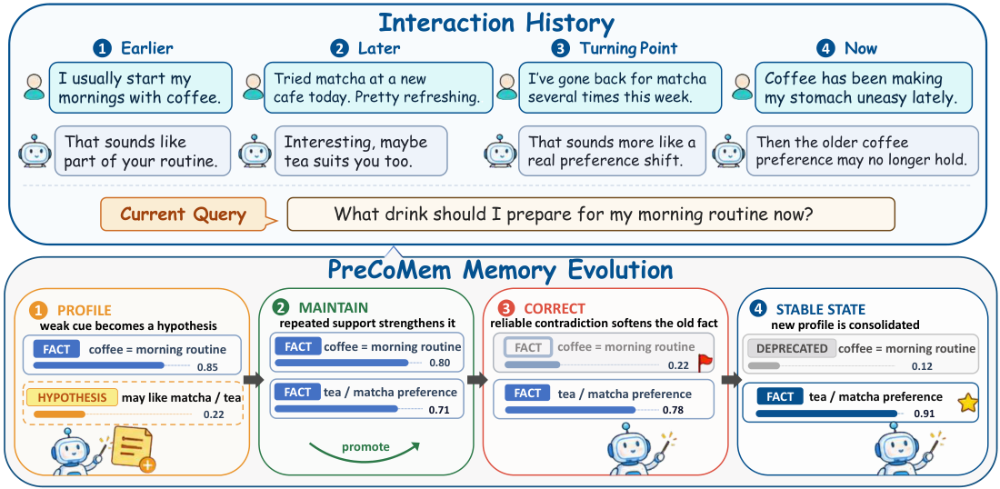

<div align="center">

# PreCoMem：面向自演化长期对话智能体的预测认知记忆

**NeurIPS 2026**

[English](README.md) | 简体中文


[](LICENSE)
[](pyproject.toml)
[](https://github.com/ZhongWishing/PreCoMem/actions/workflows/tests.yml)

Jian Zhong<sup>1*</sup>, Zeyu Liu<sup>1*</sup>, Pingchuan Cao<sup>1</sup>, Rongduo Han<sup>1</sup>, Shunye Tang<sup>1</sup>, Guohuan Xie<sup>3</sup>, Mingyuan Qin<sup>4</sup>, Ran Ji<sup>5</sup>, Xiao Liang<sup>2</sup>, Wei Wang<sup>1†</sup>, Haining Zhang<sup>1†</sup>

<sup>1</sup>南开大学 &nbsp; <sup>2</sup>vivo AI Lab &nbsp; <sup>3</sup>清华大学 &nbsp; <sup>4</sup>华中科技大学 &nbsp; <sup>5</sup>中国科学院大学

<sup>*</sup>共同第一作者 &nbsp;&nbsp; <sup>†</sup>通讯作者

</div>

<p align="center">
  
</p>
<p align="center"><em>论文图 1。PreCoMem 管理事实与假设的生命周期，在相互冲突的信念状态之间平稳过渡。</em></p>

## 概述

长期对话智能体既要让用户记忆足够稳定以支持个性化，又要在用户真正发生变化时及时更新。PreCoMem 是一个受预测编码启发的记忆巩固框架。它把记忆表示为关于用户的、带置信度权重的信念，并用一个考虑检索可靠性的预测误差信号来修正这些信念。

每一轮对话中，PreCoMem 先召回 Top-K 条信念，再计算**有效惊奇度** $S_{\mathrm{eff}} = \rho_t \cdot S_{\mathrm{raw}}$。其中原始项融合了语义偏离和 NLI 矛盾分数。当检索得分分布较为分散时，可靠性系数 $\rho_t$ 会压低这一信号。随后，双阈值门控把该轮路由到三个确定性算子之一：

| 区间 | 条件 | 更新 |
|---|---|---|
| `MAINTAIN` | $S_{\mathrm{eff}} \le \theta_{\mathrm{low}}$ | 强化得到支持的信念：$w \leftarrow w + \eta\,(1-w)$ |
| `PROFILE` | $\theta_{\mathrm{low}} < S_{\mathrm{eff}} \le \theta_{\mathrm{high}}$ | 写入一条低置信度假设（即"等候区"） |
| `CORRECT` | $S_{\mathrm{eff}} > \theta_{\mathrm{high}}$ | 软衰减被反驳的信念 $w \leftarrow w\, e^{-\beta S_{\mathrm{eff}} \zeta}$，并记录新的观察 |

假设在获得反复支持后晋升为事实，若始终得不到支持则被剪除。LLM 子智能体只决定*修改哪些*信念以及*修改力度*。门控、强化、衰减、晋升和剪枝全部是闭式规则，因此记忆规模有界，每一次更新都可审计。

本仓库包含：

- `precomem/`：框架本体（论文算法 1），带类型化配置、逐轮轨迹记录和记忆持久化。
- LoCoMo、LongMemEval-S、PersonaMem-v2 和 DiMoBench 的评测框架，QA 与评判 prompt 与附录 F 逐字一致。
- **DiMoBench** 与 **DiMoBench-XL** 的六阶段"生成器–验证器"构建流程。
- 论文中每一项消融与对照实验对应的配置开关。
- 无需 API key、无需下载模型的离线单元测试。

## 安装

需要 Python 3.9 或更高版本。

```bash
git clone https://github.com/ZhongWishing/PreCoMem.git
cd PreCoMem
python -m venv .venv && source .venv/bin/activate
pip install -e ".[models,gemini]"
```

| 可选依赖 | 安装内容 | 用途 |
|---|---|---|
| `models` | `torch`、`transformers`、`sentence-transformers` | 论文所用的嵌入模型和 NLI 验证器 |
| `gemini` | `google-genai` | 两个辅助评判模型和 DiMoBench 验证器 |
| `calibrate` | `datasets` | 在 MNLI 上拟合 NLI 温度 |
| `dev` | `pytest`、`ruff` | 测试与代码检查 |

`pip install -e ".[all]"` 会安装全部依赖。然后设置所用服务的 API key：

```bash
export OPENAI_API_KEY=...    # 主干模型与主评判模型
export GEMINI_API_KEY=...    # 辅助评判模型与 DiMoBench 验证器
```

如果没有安装 `models`，PreCoMem 会退回到哈希嵌入和启发式矛盾检测器。这样流程仍能跑通，可用于冒烟测试，但无法复现论文数字。设置 `PRECOMEM_STRICT_EMBEDDER=1` 和 `PRECOMEM_STRICT_NLI=1` 可以把这两种退回改为直接报错。

## 模型

PreCoMem 无需训练，也不附带自有权重。它依赖两个公开模型，首次使用时会自动下载：

- 稠密嵌入：[`Qwen/Qwen3-Embedding-0.6B`](https://huggingface.co/Qwen/Qwen3-Embedding-0.6B)
- 矛盾验证器：[`cross-encoder/nli-deberta-v3-base`](https://huggingface.co/cross-encoder/nli-deberta-v3-base)

唯一需要拟合的量是验证器的标量温度 $T$（附录 C.2），在 MNLI matched 开发集上拟合：

```bash
precomem-calibrate-nli --out configs/nli.yaml    # 之后用 --config configs/nli.yaml 传入
```

主干模型通过 OpenAI Chat Completions API 或任意 OpenAI 兼容服务调用，例如用 vLLM 部署的 Qwen 模型（见 `configs/qwen_vllm.yaml`）。对于不接受 `max_tokens` 或 `temperature` 的推理模型，客户端会自动适配。额外的请求字段可以用 `--set backbone.extra_params.reasoning_effort=minimal` 传入。

## 快速上手

```python
from precomem import PreCoMem, load_config

agent = PreCoMem(load_config())
for utterance in [
    "I usually start my mornings with coffee.",
    "I tried matcha at a new cafe today, pretty refreshing.",
    "Coffee has been making my stomach uneasy lately.",
    "I really don't drink coffee anymore at all.",
]:
    trace = agent.step(utterance)   # 检索、回复、惊奇度、门控、算子、生命周期
    print(trace.one_line())

print(agent.render_memory())        # 带类型、置信度和来源的信念
print(agent.query("What should I drink tomorrow morning?"))
agent.save_memory("memory.json")    # 信念库、情景缓存和主题表
```

- `agent.observe(user, assistant, meta=...)` 回放一段已记录的对话，不生成回复。评测时使用的就是这种方式。
- `agent.recall(question)` 执行只读的 Top-K 检索。
- 每个 `TurnTrace` 都记录检索到的证据、惊奇度各分量、门控决策、闭式更新、生命周期计数、延迟和 token 用量。

同一个示例也可以通过命令行 `precomem-demo` 运行。

## 数据

把各基准的数据文件放到 `data/` 目录下（该目录不纳入 git）。

| 基准 | 来源 | 下文命令使用的路径 |
|---|---|---|
| LoCoMo | [snap-research/locomo](https://github.com/snap-research/locomo)（`data/locomo10.json`） | `data/locomo10.json` |
| LongMemEval-S | [xiaowu0162/LongMemEval](https://github.com/xiaowu0162/LongMemEval)（500 题的 S 子集） | `data/longmemeval_s.json` |
| PersonaMem-v2 | [bowen-upenn/ImplicitPersona](https://huggingface.co/datasets/bowen-upenn/ImplicitPersona)，入口见 [bowen-upenn/PersonaMem](https://github.com/bowen-upenn/PersonaMem) | `data/personamem_v2_32k.json`、`data/personamem_v2_128k.json` |
| DiMoBench / -XL | 用 `precomem-build-dimobench` 构建（[见下文](#dimobench-与-dimobench-xl)） | `data/dimobench/suite.json`、`data/dimobench_xl/suite.json` |

LoCoMo 和 LongMemEval 的加载器直接读取官方发布格式。LongMemEval 另外发布了清洗后的 S 子集（`longmemeval_s_cleaned.json`），格式相同。PersonaMem-v2 需要先转换成 [`precomem/benchmarks/personamem.py`](precomem/benchmarks/personamem.py) 中说明的按用户组织的格式，即每个用户一条记录，包含其对话 `history` 和 `questions`。

## 复现论文结果

所有运行都使用三个随机种子 `{13, 42, 1234}`，并采用第 3.1 节的评判协议。每个回答由一个 `gpt-4.1-mini` 主评判和两个使用不同 system prompt 的 `gemini-2.5-flash` 辅助评判打分，准确率取三个二元判定的平均值。

```bash
# 表 1，LoCoMo：gpt-4o-mini 部分（默认）与 gpt-4.1 部分
precomem-run --benchmark locomo --data data/locomo10.json
precomem-run --benchmark locomo --data data/locomo10.json --backbone gpt-4.1

# 表 1，LongMemEval-S：gpt-4.1 部分（默认）；表 7：gpt-4o-mini
precomem-run --benchmark longmemeval --data data/longmemeval_s.json
precomem-run --benchmark longmemeval --data data/longmemeval_s.json --backbone gpt-4o-mini

# 图 3(e)-(f)，gpt-4.1 下的 PersonaMem-v2（选择题与开放式问题）
precomem-run --benchmark personamem --data data/personamem_v2_32k.json
precomem-run --benchmark personamem --data data/personamem_v2_128k.json

# 第 3.3 节，DiMoBench 与 DiMoBench-XL
precomem-run --benchmark dimobench --data data/dimobench/suite.json
precomem-run --benchmark dimobench --data data/dimobench_xl/suite.json
```

| 参数 | 作用 |
|---|---|
| `--backbone gpt-4.1`、`--base-url http://host:8000/v1` | 指定主干模型；任何 OpenAI 兼容服务均可 |
| `--config configs/dynamic_threshold.yaml` | PreCoMem(DT)，即自适应阈值变体（附录 D.5） |
| `--set retrieval.top_k=5 --set gate.theta_high=0.7` | 覆盖任意配置项 |
| `--seeds 13 --limit 20 --workers 8` | 部分运行或加速运行 |
| `--skip-judge` | 只做推理，不评判 |

每次运行写出 `results/<benchmark>_<timestamp>/`：

| 文件 | 内容 |
|---|---|
| `run_meta.json` | 解析后的完整配置、所用模型、包版本和 git commit |
| `seed_<n>/predictions.jsonl` | 每题一条记录：预测、各评判投票、检索到的信念 id 与权重、Top-K 中低置信项占比、prompt token 数 |
| `seed_<n>/traces/<sample>.jsonl` | 每段回放对话一条记录（即算法 1 的轨迹） |
| `seed_<n>/memory/<sample>.json` | 最终的信念库、情景缓存和主题表 |
| `summary.json` | 各类别准确率的跨种子均值 ± 标准差，以及回答模型的 token 用量 |

影响复现的协议细节：

- 回答模型收到的记忆输入与论文统计 token 时的口径完全一致：为该问题召回的 Top-K（K = 10）条信念、至多 8 条关联的情景片段，以及最近 6 轮的工作窗口。置信度权重从不展示给回答模型。
- LoCoMo 采用官方发布数据的类别编号（1 多跳、2 时间、3 开放域、4 单跳），并排除第 5 类对抗题，因此得到表 1 中的 1,540 道题。
- LongMemEval-S 的每道题都带有提问日期。由于时间类问题以该日期为参照，日期会附加在问题之后。
- DiMoBench 的题目带有 `anchor_turn`，会在回放到该轮之后立即提问，因此答案反映的是当时的信念状态。
- 每回放一段对话调用一次子智能体；每道题调用一次回答模型和三次评判模型。

## 结果

下列数字摘自论文，为 LLM 评判准确率（%），以三个种子的均值 ± 标准差给出。*Avg. tokens* 指每道题输入回答模型的平均 token 数。

**LoCoMo**（表 1，1,540 道题）

| 主干模型 | Single-Hop | Multi-Hop | Temporal | Open-Domain | Overall | Avg. tokens |
|---|:-:|:-:|:-:|:-:|:-:|:-:|
| gpt-4o-mini | 81.41 ± 0.51 | 68.49 ± 0.98 | 66.21 ± 0.12 | 39.63 ± 0.25 | **73.57 ± 0.28** | 3.3k |
| gpt-4.1 | 90.41 ± 0.35 | 83.48 ± 0.29 | 84.74 ± 0.80 | 48.23 ± 0.65 | **85.06 ± 0.07** | 3.1k |

最强基线 TiMem 的总体准确率为 71.88（gpt-4o-mini）和 84.04（gpt-4.1）。

**LongMemEval-S**（gpt-4.1 见表 1，gpt-4o-mini 见表 7，500 道题）

| 主干模型 | SSU | SSA | SSP | MS | KU | TR | Overall | Avg. tokens |
|---|:-:|:-:|:-:|:-:|:-:|:-:|:-:|:-:|
| gpt-4o-mini | 91.58 ± 0.04 | 86.38 ± 0.19 | 79.40 ± 0.81 | 84.84 ± 0.22 | 87.13 ± 0.56 | 80.34 ± 0.73 | **84.28 ± 0.05** | 4.1k |
| gpt-4.1 | 94.09 ± 0.98 | 90.72 ± 0.12 | 83.93 ± 0.85 | 87.44 ± 0.99 | 91.80 ± 0.87 | 84.35 ± 0.83 | **89.39 ± 0.76** | 3.8k |

最强基线 EverMemOS 的总体准确率为 82.32（gpt-4o-mini）和 86.16（gpt-4.1）。

**PersonaMem-v2**（图 3，gpt-4.1）。开放式问题准确率在 32k 上下文下为 72.31，在 128k 下为 67.84，分别比 EverMemOS 高 3.37 和 2.89 个点。

**DiMoBench**（图 4）。偏好发生转变后，PreCoMem 恢复最快并稳定在 84%，而 EverMemOS、TiMem 和 O-Mem 停留在 78–80%。

附录 D.1 中 AMemGym 和 LoCoMo-Plus 的结果按照这两个基准的官方协议得到，不在本仓库评测脚本的覆盖范围内。

## 消融与对照实验

论文中的每一项消融都对应一个配置开关，因此主实验和消融实验只差命令行参数。

```bash
precomem-run --benchmark locomo --data data/locomo10.json --set ablation.es=true
precomem-run --benchmark locomo --data data/locomo10.json --set surprisal.lambda=0
precomem-run --benchmark locomo --data data/locomo10.json --set "ablation.random_routing=[0.562,0.274,0.164]"
precomem-run --benchmark dimobench --data data/dimobench/suite.json --set ablation.without_profile=true
```

| 开关 | 含义 |
|---|---|
| `ablation.es=true` | 门控分数强制为 0，有证据的轮次全部走 `MAINTAIN`（只强化的下界） |
| `ablation.rr=true` | 检索可靠性 $\rho_t = 1$ |
| `ablation.cw=true` | 每次写入后把所有信念权重覆盖为 1：检索不加权、假设立即晋升、不再剪枝 |
| `ablation.read_time_weighting=false` | 只去掉检索打分中的 $w_t(m)$（析因对照） |
| `ablation.without_maintain=true`、`ablation.without_correct=true` | 对应区间照常触发，但不做任何更新 |
| `ablation.without_profile=true` | 中等惊奇度的观察直接写成事实，跳过等候区 |
| `ablation.single_threshold=true` | 中间区间改为路由到 `CORRECT` |
| `ablation.random_routing=[pM,pP,pC]` | 按频率匹配的随机路由，读路径保持不变 |
| `surprisal.lambda=0` 或 `=1` | 从 $S_{\mathrm{raw}}$ 中去掉 $d_{\mathrm{sem}}$ 或 $d_{\mathrm{conf}}$ |
| `lifecycle.fact_optional_prune=0.05` | 硬剪除低置信度事实（事实剪枝消融） |
| `gate.adaptive=true` | PreCoMem(DT) |

## DiMoBench 与 DiMoBench-XL

DiMoBench 专门考察在渐进、隐式的信念漂移和对抗性检索干扰下的*写路径*。`precomem/dimobench/` 实现了附录 D.6 的六阶段构建流程，并严格分离生成器与验证器。

| 阶段 | 内容 | 模型 |
|:-:|---|---|
| 1 | 用户画像：大五人格、人生阶段、带易混淆人名的社交圈、漂移触发事件 | 生成器 |
| 2 | 生活骨架：各 session 摘要，以及说明"哪个隐式事件表达哪个槽位状态"的 *cue 脚本* | 生成器 |
| 3 | 对话：在滚动摘要下按顺序逐个生成 10 轮的 session，每个 cue 都定位到具体轮次 | 生成器 |
| 4 | 问题：按固定配额网格，每个（推理类别 × 干扰标签）格生成一题，并附证据指针 `D{session}:{turn}` | 生成器 |
| 5 | 按六项标准验证；`REVISE` 带反馈重新生成（至多 3 轮），`REJECT` 直接丢弃 | 验证器 |
| 6 | 20% 分层审计样本、标注表和 Cohen's κ 计算工具 | 离线 |

`precomem/dimobench/spec.py` 固定了全部结构，LLM 各阶段只负责填充语言。基础版有 35 个 10 轮的 session，在第 200 轮发生漂移。第 21 个 session 中的 4 个隐式事件引出漂移，第 22–24 个 session 给出密集线索，第 25–35 个 session 为低频维持阶段。每 30 轮注入一次干扰，200 道题按变化前 90、变化点 10、变化后 100 分布。XL 版有 105 个 session、5 个属性槽位，并在第 280、580、870 轮发生三次漂移。每次漂移通过 22 条线索表达，每 50 轮一个窗口、每窗口 20 道题（每个用户 420 道）。

```bash
precomem-build-dimobench --variant base --out data/dimobench        # 生成器 GPT-4o，验证器 Gemini-2.5-Pro
precomem-build-dimobench --variant xl   --out data/dimobench_xl
precomem-build-dimobench --variant base --personas persona_a --max-sessions 4 --max-qa 10   # 低成本冒烟运行
```

用户种子见 [`precomem/configs/dimobench_personas.yaml`](precomem/configs/dimobench_personas.yaml)。构建过程在 `<out>/_work/` 下为每个阶段保存检查点，中断后自动续跑。每个用户的输出文件包含对话、各槽位的真实状态时间线、每条计划线索及其落地轮次、带验证结论的问题，以及构建统计。`audit/` 目录存放标注表。由于生成过程具有随机性，重新构建得到的数据在措辞上会与论文所用对话不同。

## 配置

全部超参数位于 [`precomem/configs/default.yaml`](precomem/configs/default.yaml)，并被解析为带类型和校验的 dataclass（`precomem/config.py`）。未知键名或违反约束的取值（例如假设区间越过 $\tau_{\mathrm{promote}}$）会在加载时直接报错。

| YAML 键 | 论文符号 |
|---|---|
| `retrieval.top_k`、`retrieval.alpha.{semantic,bm25,topic}` | 式 1 中的 $K$ 与 $(\alpha_1, \alpha_2, \alpha_3)$ |
| `surprisal.lambda`、`surprisal.reliability_eps` | 式 4 中的 $\lambda$ 与式 3 中的 $\epsilon$ |
| `gate.theta_low`、`gate.theta_high` | 式 6 中的 $(\theta_{\mathrm{low}}, \theta_{\mathrm{high}}) = (0.2, 0.6)$ |
| `gate.adaptive*` | PreCoMem(DT)：窗口、权重、阈值范围和平滑系数 |
| `operators.maintain.eta_{min,max}` | 式 7 中 $\eta_t(m)$ 的截断范围 |
| `operators.profile.{explicit,latent}_band` | 式 8 中各类别的区间 $[w_{\min}, w_{\max}]$ |
| `operators.correct.beta`、`operators.correct.new_fact_weight` | 式 10 中的 $\beta$，以及新信念节点的权重 |
| `lifecycle.decay_gamma`、`lifecycle.promote_threshold`、`lifecycle.hypothesis_prune` | 式 9 中的 $\gamma$、$\tau_{\mathrm{promote}} = 0.80$ 和剪枝阈值 0.10 |
| `retrieval.short_term_window`、`retrieval.max_provenance_traces` | 回答输入中的 6 轮窗口和 8 条片段上限 |
| `nli.temperature` | 校准后验证器的温度 $T$ |
| `backbone.extra_params` | 合并进每次主干模型请求的额外字段 |
| `ablation.*` | 上文列出的消融开关 |

## 目录结构

```
precomem/
  agent.py          PreCoMem：算法 1（observe / step / recall / query、轨迹、持久化）
  config.py         类型化配置、YAML 加载与校验
  gate.py           双阈值门控，含固定阈值与自适应（DT）阈值策略
  trace.py          逐轮轨迹记录
  memory/           MemoryItem、EpisodicTrace、BeliefStore、EpisodicCache、TopicTable、MemoryState
  retrieval/        置信度调制的三信号检索器、BM25 与嵌入模型
  surprisal/        rho_t、d_sem、d_conf、S_raw 与 S_eff，以及校准后的 NLI 验证器
  operators/        MAINTAIN、PROFILE、CORRECT 与假设生命周期
  llm/              模型调用客户端（OpenAI 兼容与 Gemini）及子智能体 prompt
  benchmarks/       LoCoMo、LongMemEval-S、PersonaMem-v2 与 DiMoBench 的加载器
  evaluation/       QA 与评判 prompt、评判集成、指标与评测运行器
  dimobench/        构建流程（spec、schema、prompts、pipeline、audit）
  cli/              precomem-run、precomem-demo、precomem-build-dimobench、precomem-calibrate-nli
  configs/          default.yaml 与 dimobench_personas.yaml
configs/            示例覆盖配置（gpt-4.1、PreCoMem(DT)、vLLM 主干、离线冒烟测试）
tests/              离线单元测试
```

## 测试

```bash
pip install -e ".[dev]"
pytest
```

测试全部离线运行，几秒内完成。测试用论文中的算例核对闭式更新，例如 `PROFILE` 初始化 $w_0 = 0.6549$（附录 C.3），以及未获支持的潜在推断类假设在连续 8 轮无支持后被剪除。测试还覆盖门控、生命周期、检索、每个消融开关、各基准加载器、带锚定提问的评测运行器、模型调用客户端，以及使用脚本化生成器与验证器替身的完整 DiMoBench 流程。

## 许可证

代码以 [MIT 许可证](LICENSE)发布。评测所用各基准沿用其原始许可证。

## 联系方式

问题与 bug 请提交 [GitHub issue](https://github.com/ZhongWishing/PreCoMem/issues)，也可以联系 Jian Zhong（zhongjian@mail.nankai.edu.cn）。
